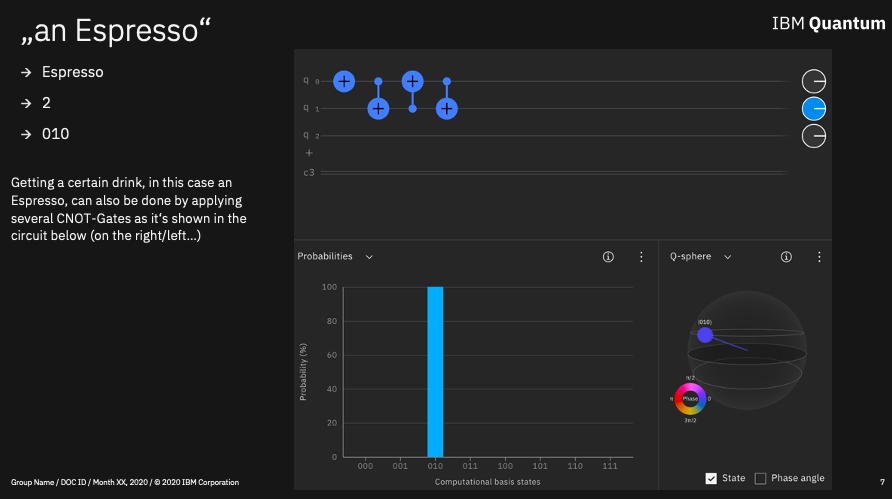
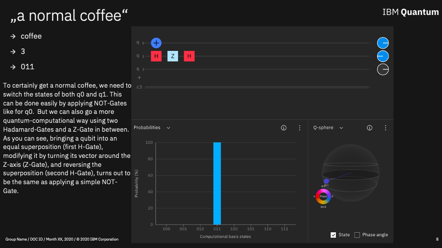
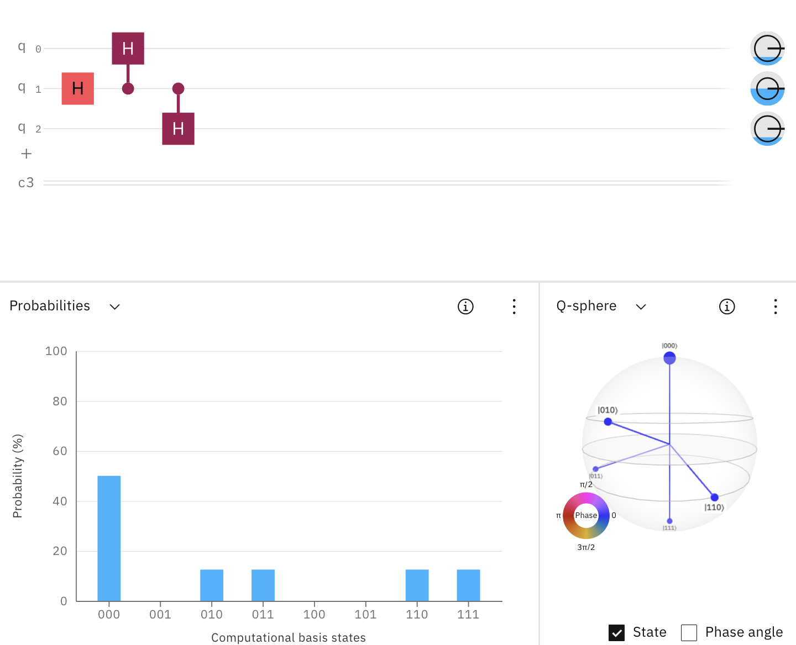
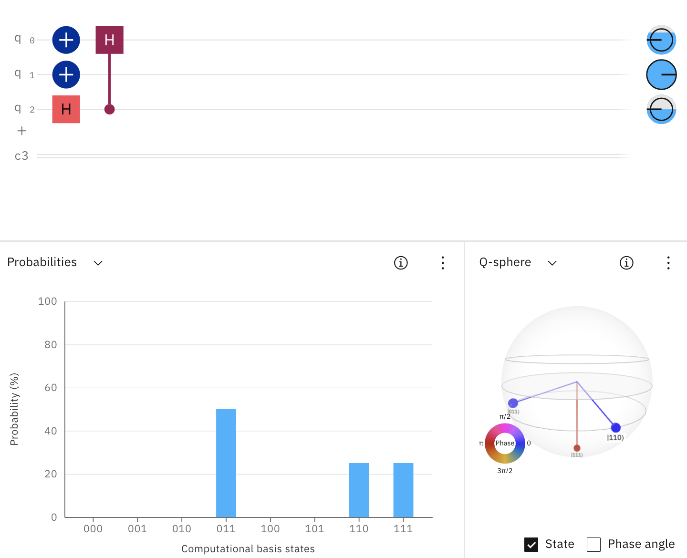
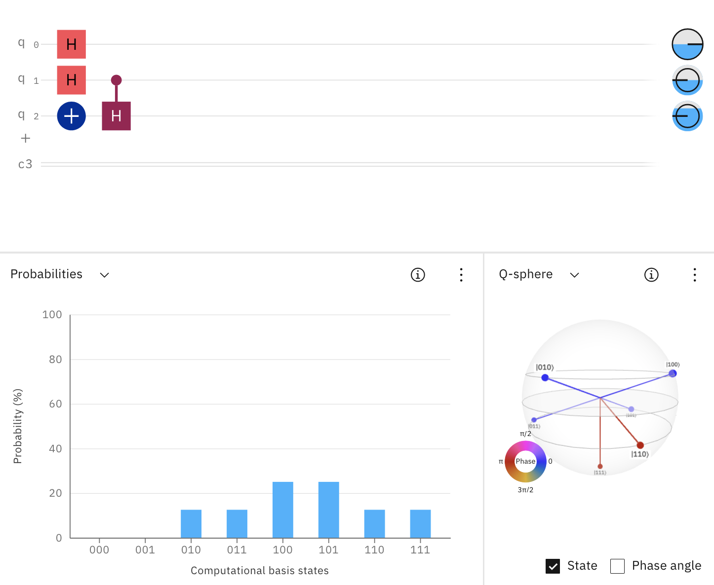
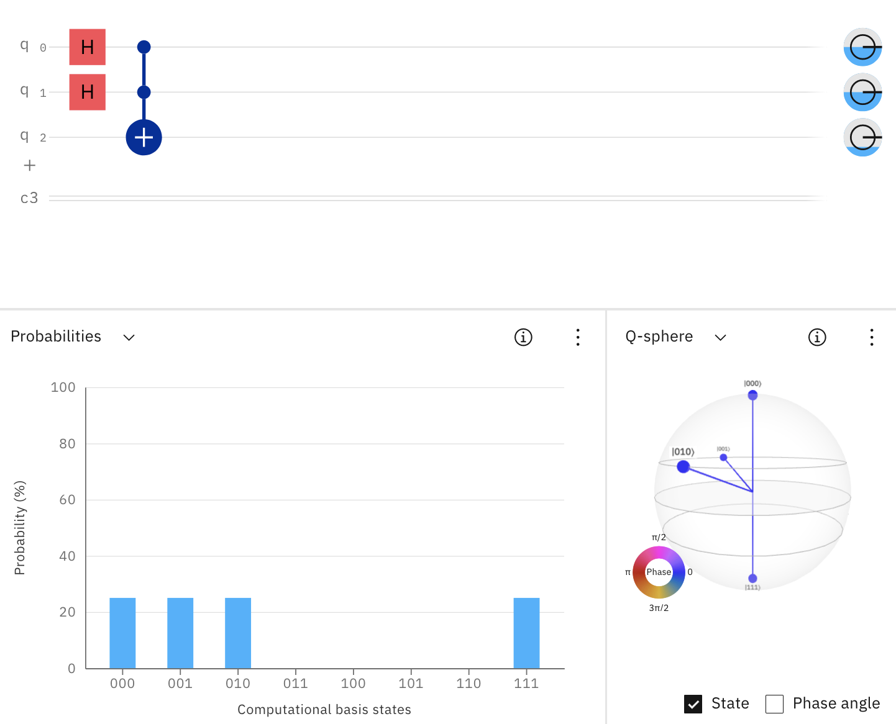
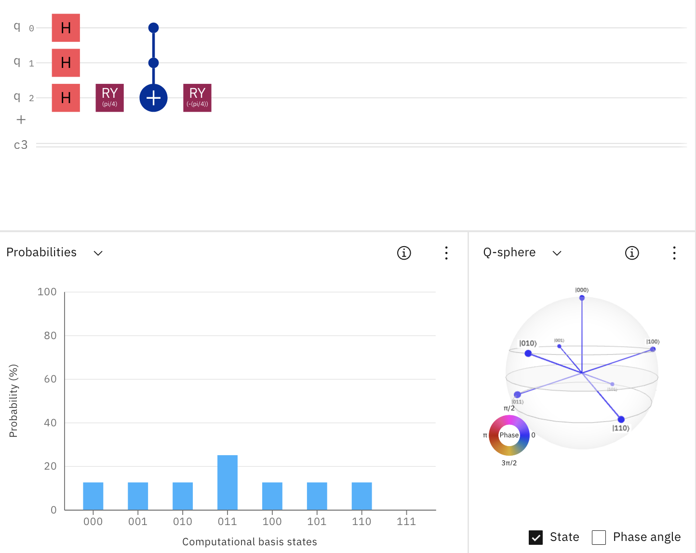

# Advanced Exercises 
To spice up your beverage selection, try to find quantum circuits that solve the following advanced exercises. 
We provide examples for the first few, but these are not the only possible approach. Give it a shot yourself and come up with individual Quoffe solutions or explore alternative Circuit options.

### 10) I want an Espresso by using single-qubit gates only on q0

To select an Espresso (2, 010), qubit q1 needs to be measured as "1". This can be achieved by using a swap gate, or three CNOT gates as shown in the following solution. 
 [Try this circuit in IBM Quantum Composer](https://quantum-computing.ibm.com/composer/files/new?initial=N4IgdghgtgpiBcICSACA7hMAXFmUFEBnABwCcZDCB7AGhQCMBXHDbFLK3Y4gGwE9cPHikIBLMAHMeMFAEdG9UTgkQsFdp1kAGFFTD8QNELIiEoCEAHkACvgByARQCCAZQCyKAEwA6LQG4AHTBxAGMeRgATGQDjGB5RegBGb1CYwLAg2XIJOQBtAGYAXXSQ7JQQguKgoIAPPK0qsBC62VyGmlbExua8ro627paB-q6-QxAowlLRYixRPQsQAF8gA).

### 11) I want a regular Coffee but want to use only one X-Gate (plus other gates as needed)

To ensure getting a regular coffee (3, 011), we need to switch the states of both q0 and q1 from 0 to 1. 
Instead of applying a second NOT gate, you can use the following circuit identity: NOT = H Z H with Z being the Z gate.  
[Try this circuit in IBM Quantum Composer](https://quantum-computing.ibm.com/composer/files/new?initial=N4IgdghgtgpiBcICSACA7hMAXFEVgHsAnKCAGxQGMCAzGmGAGhQCMBXHDbFLAlNgM4wUBMGQCeIsMIEBLMAHMywgBoBaAOIQswgBQAHMoJ4ALYQSxmiKBdpgDcD6TAAmrgJQhGIAI4QBUAggAPIACgCiAHIAigCCAMoAsigATAB0AAwA3AA6YPKURm4oOb4wZLIsAIxpBaW5YHk%2BRDAKKD4A2gDMALoNlC1tlN19eXkAHu0dGaNgJlNVswBeC7PznYtZXiBuAgOy%2BliyokEgAL5AA).

### 12) I want a Tea or something strong, but I prefer Tea

Goal: Tea (0, 000) or Espresso (2, 010) or Coffee (3, 011) or Viennese Melange (6, 110) or Americano (7, 111), but Tea with a higher probability.

### 13) I want something strong, but preferably an Espresso
Goal: Espresso (2, 010) or Viennese Melange (6, 110) or Americano (7, 111) with higher probability for an Espresso than for Viennese Melange and Americano.

### 14) I want something with caffein

Goal: Espresso (2, 010) or Coffee (3, 011) or Cappuccino (4, 100) or Latte Macchiato (5, 101) or Viennese Melange (6, 110) or Americano (7, 111).

### 15) I want either something without caffein or something with much caffein but without milk (CCX Gate)

Goal: Tea (0, 000) or Hot Chocolate (1, 001) or Espresso (2, 010) or Americano (7, 111).

### 16) I want something to drink, it doesn’t matter what, preferably a Coffee, but no Americano

Goal: Tea (0, 000) or Hot Chocolate (1, 001) or Espresso (2, 010) or Coffee (3, 011) or Cappuccino (4, 100) or Latte Macchiato (5, 101) or Viennese Melange (6, 110), Coffee should have the highest probability.

